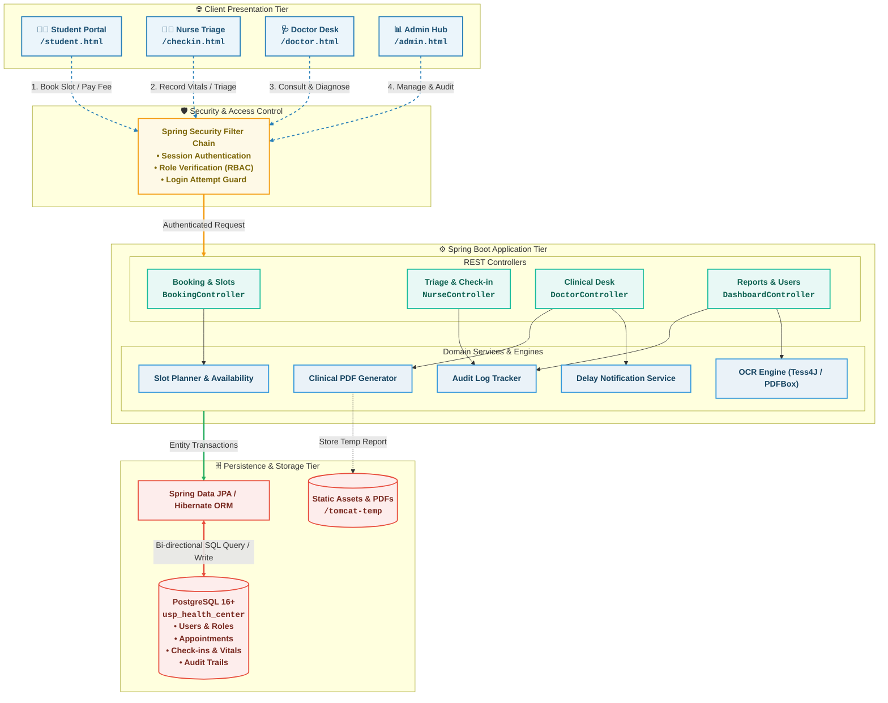

# USP Laucala Health Center Management System (HMS)

An integrated, enterprise web-based healthcare management system engineered for The University of the South Pacific (USP), Laucala Campus (Suva, Fiji). The platform digitizes and modernizes clinic appointments, nursing triage assessments, doctor clinical consultations, student medical records, and administrative analytics while adhering to Fiji Local Time (`Pacific/Fiji`, GMT+12) and university operating schedules.

---

## System Overview

The USP Health Center Management System replaces paper-heavy clinical clinic workflows with a role-based, secure digital healthcare platform:

- **Strict Role-Based Access Control (RBAC):** Distinct workflows for `STUDENT`, `NURSE`, `DOCTOR`, and `ADMIN`.
- **Fiji Time Standard:** Temporal synchronization pinned to Fiji Local Time (`Pacific/Fiji`, GMT+12) across schedule slot creation, appointments, triage timestamps, and delay notifications.
- **Privacy Architecture:** Complete separation between clinical medical records (diagnoses, clinician notes, patient history) and administrative reporting (aggregated statistics, fee schedules, doctor rosters).

---

## Key Modules & Capabilities

1. **Public Information Portal (`/`, `/services.html`, `/schedule.html`)**

   - Live campus clinic operational schedules (Semester, Mid-Semester, and Vacation periods).
   - Lunch recess handling (1:00 PM – 2:00 PM) and emergency contact guidance (+679 3231618).
   - Overview of health services (General Consultations, Preventative Screenings, Wound Care, Emergency Support).
2. **Student Self-Service Portal (`/student.html`)**

   - Account registration with Local (Fiji) vs. Regional student residency detection.
   - Health Services Fee receipt upload (PDF) with automated OCR keyword/amount extraction and admin approval queue.
   - Interactive doctor appointment booking, rescheduling, and cancellation with real-time slot availability.
   - Private consultation summaries, digital medical records ordering, and one-tap emergency alert dispatch.
3. **Nursing & Triage Workspace (`/checkin.html`)**

   - Live patient arrivals management and student lookup directory.
   - Comprehensive vitals capture: Body Temperature (°C), Systolic/Diastolic Blood Pressure (mmHg), and Presenting Complaints.
   - Instant walk-in triage and rapid emergency check-in forwarding directly to the active doctor queue.
4. **Doctor & Physician Workspace (`/doctor.html`)**

   - Dynamic clinical priority queue automatically prioritizing critical emergencies over scheduled consultations.
   - Integrated triage vitals review and historical patient consultation summaries with immutable clinician attribution.
   - Real-time clinical diagnosis, prescription/treatment note recording, and consultation closeout.
   - Personal schedule inspection, clinician delay notice broadcasts, and clinical audit report exports (PDF / JSON).
5. **Admin Reporting, Roster & System Management (`/admin.html`, `/admin-user.html`)**

   - **Executive Analytics:** Real-time summary cards (total appointments, no-show count, no-show rate), date-range filtering, and interactive distribution charts (by visit reason and doctor caseload).
   - **Fee Settings:** Dynamic configuration of Health Services Fee amounts for Local Fiji Citizens and Regional students.
   - **Receipt Verification:** Workflow to inspect student-uploaded payment receipts and approve or reject fee exemptions.
   - **Staff & User Management:** Provision and manage doctor, nurse, and administrator accounts.
   - **Master Schedule Rostering:** Maintain weekly physician working shifts, consultation slot capacities, and off-duty periods.
   - **System Audit Logs:** Immutable tracking of user authentications, administrative changes, and system operations.

---

## System Architecture

The following diagram illustrates the multi-tier architectural flow from browser clients through the security layer, REST controllers, business domain services, and persistence tiers:



---

## Default Portals & Seeded Test Accounts

When launched, the system automatically seeds default accounts and sample appointments into the database on first run.

| Role                      | Portal URL                                | Username                        | Default Password  | Primary Responsibilities                           |
| :------------------------ | :---------------------------------------- | :------------------------------ | :---------------- | :------------------------------------------------- |
| **Public / Home**   | `http://localhost:8080/`                | *N/A*                         | *Public Access* | Clinic hours, service info, navigation gateway     |
| **Unified Sign In** | `http://localhost:8080/login.html`      | —                              | —                | Role-based authentication gateway                  |
| **Student**         | `http://localhost:8080/student.html`    | Self-registered / `S11234567` | *User created*  | Book slots, upload receipts, view consultations    |
| **Nurse**           | `http://localhost:8080/checkin.html`    | `nurse`                       | `nurse123`      | Patient arrival check-in, vitals recording, triage |
| **Doctor**          | `http://localhost:8080/doctor.html`     | `dr.sharma`                   | `doctor123`     | Patient queue, clinical consultations, diagnoses   |
| **Admin**           | `http://localhost:8080/admin.html`      | `admin`                       | `admin123`      | Analytics dashboard, receipts, schedules, fees     |
| **User Admin**      | `http://localhost:8080/admin-user.html` | `admin`                       | `admin123`      | Staff account provisioning, system audit logs      |

---

## Technology Stack

- **Backend:** Java 17+, Spring Boot 3.x, Spring Data JPA / Hibernate, Spring Security
- **Database:** PostgreSQL (v16+)
- **Frontend:** Vanilla HTML5, CSS3 (Modern Responsive Theme & Glassmorphism UI), Vanilla JavaScript (Async Fetch API)
- **Document Services:** Apache PDFBox (OCR receipt parsing, automated PDF consultation audit report generation)
- **Build Tool:** Maven with provided wrapper scripts (`./mvnw`, `mvnw.cmd`)

---

## Repository Structure

```
usp-health-center-system/
├── .mvn/                                # Maven wrapper configuration
├── mvnw / mvnw.cmd                      # Cross-platform Maven wrapper scripts
├── pom.xml                              # Project dependencies, plugins, and build specs
├── SETUP.md                             # Step-by-step developer environment setup guide
├── README.md                            # Main project documentation & overview
└── src/
    ├── main/
    │   ├── java/com/example/demo/       # Java backend source code
    │   │   ├── *Controller.java         # REST & web endpoints (Booking, Doctor, Nurse, Admin)
    │   │   ├── *Service.java            # Business logic (OCR, PDF, FeeSettings, Audit)
    │   │   ├── *Repository.java         # Spring Data JPA persistence interfaces
    │   │   ├── *.java                   # JPA entity models (Appointment, User, CheckIn, AuditLog)
    │   │   ├── SecurityConfig.java      # Spring Security configuration and RBAC route rules
    │   │   ├── DataSeeder.java          # First-boot automatic database seed script
    │   │   └── DemoApplication.java     # Spring Boot application entry point
    │   └── resources/
    │       ├── application.properties   # Local DB & runtime config (developer created)
    │       └── static/                  # Client-side web portals
    │           ├── *.html               # Role portals (index, student, checkin, doctor, admin)
    │           ├── css/                 # Modern responsive styling & design system
    │           ├── js/                  # Client-side controller logic & Fetch API workflows
    │           └── images/              # Logos and UI assets
    └── test/java/com/example/demo/      # Automated backend unit & integration tests
```

---

## Key REST API Endpoints

The backend provides authenticated REST endpoints supporting the role portals:

| Method | Endpoint | Allowed Roles | Functionality |
| :------- | :------------------------------------------------ | :--------------------- | :---------------------------------------------------------------- |
| `POST` | `/api/auth/login` | Public | Authenticates credentials and resolves role permissions |
| `GET` | `/api/slots/available?date=YYYY-MM-DD` | `STUDENT`, `ADMIN` | Returns available consultation booking slots by date |
| `POST` | `/api/appointments/book` | `STUDENT` | Schedules a new routine consultation slot |
| `GET` | `/api/appointments/my` | `STUDENT` | Retrieves active appointments and past consultation summaries |
| `POST` | `/api/student/upload-receipt` | `STUDENT` | Uploads payment PDF receipt for OCR keyword and amount extraction |
| `POST` | `/api/emergency/alert` | `STUDENT` | Dispatches immediate campus clinic emergency alert |
| `POST` | `/api/nurse/checkin` | `NURSE` | Records patient arrival vitals (Temp, BP, presenting complaint) |
| `GET` | `/api/nurse/directory` | `NURSE` | Searches verified registered student roster |
| `GET` | `/api/doctor/queue` | `DOCTOR` | Fetches dynamic queue prioritizing emergency walk-ins |
| `POST` | `/api/doctor/consultation` | `DOCTOR` | Saves clinical notes, diagnosis, and prescription plan |
| `GET` | `/api/doctor/reports/export?format=pdf` | `DOCTOR` | Generates downloadable clinical consultation audit PDF |
| `POST` | `/api/doctor/delay-notice` | `DOCTOR` | Broadcasts clinic delay notification to waiting patients |
| `GET` | `/dashboard/summary` | `ADMIN` | Delivers aggregated KPIs (total, no-shows, reasons, doctor stats) |
| `GET` | `/dashboard/summary/filter?startDate=&endDate=` | `ADMIN` | Filters executive reporting metrics by date range |
| `POST` | `/api/admin/receipts/verify` | `ADMIN` | Approves or rejects student health services fee exemptions |
| `POST` | `/api/admin/users/create` | `ADMIN` | Provisions new clinical and staff user accounts |
| `GET` | `/api/admin/audit-logs` | `ADMIN` | Retrieves immutable chronological audit log entries |

---

## Project Setup & Installation

Follow these steps in order to set up and run the system locally.

### Prerequisites

1. **Java Development Kit (JDK) 17 or newer** — verify in terminal:

   ```cmd
   java -version
   ```

2. **PostgreSQL** (version 16+ recommended) — downloadable from [postgresql.org](https://www.postgresql.org/)
3. **Git**
4. **VS Code** (recommended with *Extension Pack for Java*) or **IntelliJ IDEA**

---

### 1. Clone Repository

```cmd
git clone https://github.com/lanuongog/usp-health-center-system.git
cd usp-health-center-system
```

*(Ensure the Maven wrapper files `mvnw`, `mvnw.cmd`, and the `.mvn/` directory are present in the project root.)*

---

### 2. Confirm PostgreSQL Service

- Open Windows Search, type **Services**, and press Enter.
- Locate `postgresql-x64-<version>` in the list.
- Ensure the status is **Running**. If not, right-click and select **Start**.

---

### 3. Identify PostgreSQL Port

PostgreSQL ports vary per workstation (e.g., `5432`, `5433`, or `5434`). Determine your active port:

```cmd
netstat -ano | findstr LISTENING | findstr 543
```

Note the port number displayed in the output.

---

### 4. Create the Database

Open **pgAdmin 4**:

1. Expand **Servers** &rarr; **PostgreSQL** (enter your master password if prompted).
2. Right-click **Databases** &rarr; **Create** &rarr; **Database...**
3. Set the database name to: `usp_health_center`
4. Click **Save**.

---

### 5. Configure `application.properties`

The configuration file is kept out of Git version control to protect credentials. Create or edit:

`src/main/resources/application.properties`

```properties
spring.application.name=demo

# Match your actual PostgreSQL port and password:
spring.datasource.url=jdbc:postgresql://localhost:5434/usp_health_center
spring.datasource.password=YOUR_POSTGRES_PASSWORD

spring.datasource.username=postgres
spring.jpa.hibernate.ddl-auto=update
spring.jpa.show-sql=true
server.tomcat.basedir=./tomcat-temp
```

> **Note:** Update `5434` to your port from Step 3 and replace `YOUR_POSTGRES_PASSWORD` with your actual password.

---

### 6. Run the Application

Execute the Maven wrapper command from the project root:

```cmd
.\mvnw.cmd clean spring-boot:run
```

Wait until the console displays `Started DemoApplication` with no red `ERROR` log entries.

---

### 7. Verify and Test

1. Open your browser and navigate to `http://localhost:8080/`.
2. Access the public clinic homepage, or click **Log in to Health Portal** (`/login.html`).
3. Log in with the pre-seeded admin credentials (`admin` / `admin123`) to view the Analytics & Admin Workspace.
4. Test other roles using the test credentials listed in the [Default Portals &amp; Seeded Test Accounts](#default-portals--seeded-test-accounts) table.

---

## Shared Database Mode (Team Collaboration)

During in-person team workshops on a unified local network or hotspot, team members can point their local application instances to a shared host database:

```properties
# Shared team session database:
spring.datasource.url=jdbc:postgresql://172.20.10.4:5434/usp_health_center
spring.datasource.username=postgres
spring.datasource.password=grp123
```

> **Note:** Only active when connected to the host hotspot while the host machine is running PostgreSQL. Switch back to `localhost` for individual offline development.

---

## Troubleshooting

### "Connection refused" or "connection timeout expired"

- Your port in `application.properties` does not match the active PostgreSQL port.
- Re-run `netstat -ano | findstr LISTENING | findstr 543` and ensure the port in the connection URL matches.
- Confirm that the `postgresql-x64-*` service is in the **Running** state in Windows Services.

### "password authentication failed for user postgres"

- The password in `application.properties` is incorrect.
- To reset your password, open pgAdmin Query Tool on any database and execute:

  ```sql
  ALTER USER postgres PASSWORD 'newpassword';
  ```

  Then update `spring.datasource.password=newpassword` in `application.properties`.

### "Unable to determine Dialect without JDBC metadata"

- Occurs when database connection parameters are incomplete or invalid (e.g., blank password or wrong database name). Ensure both the database name `usp_health_center` exists and valid credentials are supplied.

### "Existing directory ... is not owned by [username]"

- Windows temporary folder permission issue. Ensure `server.tomcat.basedir=./tomcat-temp` is included in `src/main/resources/application.properties`.

### "Invalid character constant" or Corrupted Source Files

- A source file was corrupted during merge or editing. Re-fetch or re-copy the clean file from the repository.

### Whitelabel Error Page or 403 Forbidden

- The endpoint is protected by Spring Security RBAC.
- Ensure you are logged in with an account containing the required role for that path (e.g., `admin` for `/admin.html` and `/dashboard/**`, `nurse` for `/checkin.html`, `dr.sharma` for `/doctor.html`).
- If cookies persist across sessions, open an Incognito/Private window or log out explicitly.

### Browser Showing Blank or Stale UI Content

- Perform a hard browser reload: **Ctrl + F5** (Windows) or open in Incognito/Private mode.

---

## Meet The Development Team

| Name                           | Role                        |
| :----------------------------- | :-------------------------- |
| **Seiloni Tuʻungahala** | Project Manager             |
| **Aryan Singh**          | Assistant Project Manager   |
| **Lanuongo Guttenbeil**  | Chief Programmer            |
| **Kartik Pillay**        | Programmer                  |
| **Naweed Ali**           | Quality Assurance & Testing |

---

## Copyright & License

&copy; 2026 The University of the South Pacific (USP), Laucala Campus.
This system is the property of Group 1, IS314 Computing Project, 2026.
All rights reserved.
